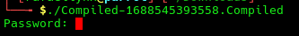
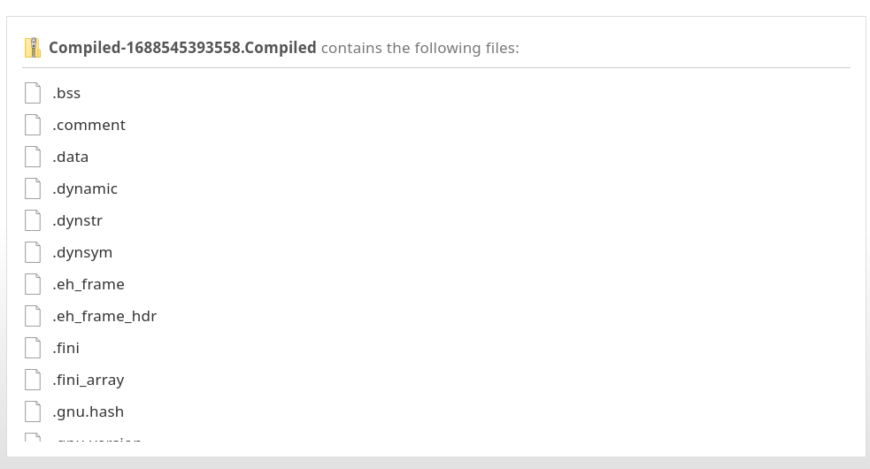
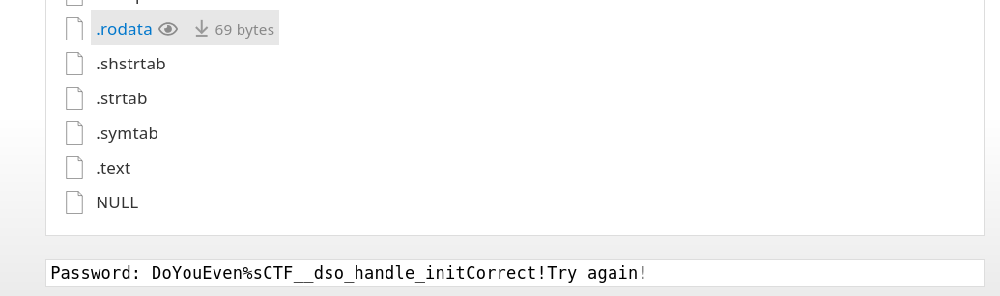
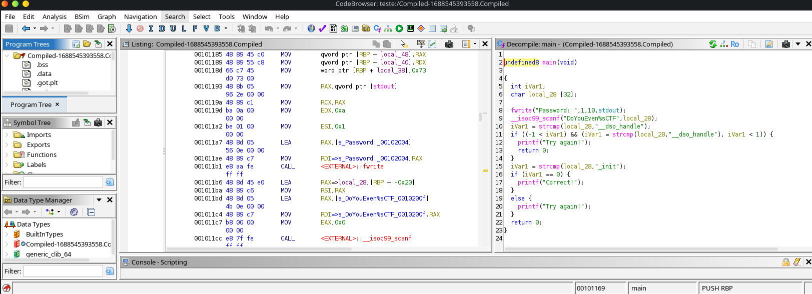
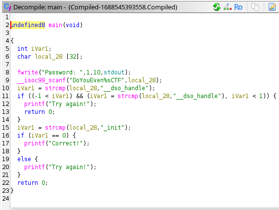
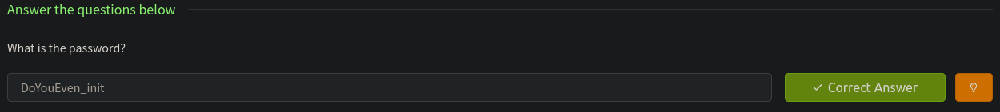

+++
author = "Rafael Vieira"
title = "Artigo - Tryhackme: Compiled"
date = 2026-09-09T15:21:00-03:00
draft = false
description = "Essa é a minha versão de artigo feita sobre à máquina compiled do tryhackme"
tags = [
  "compiled",
  "tryhackme",
  "C",
]
categories = [
  "cybersecurity",
  "development",
  "AI-Security",
]
series = ["Tryhackme"]
toc = true
image = "/images/compiled.png"
slug = "artigo-tryhackme-compiled"
+++

Olá meu nome é Rafael e estarei hoje escrevendo e mostrando o jeito que fiz o desafio compiled do tryhackme.

link: <https://tryhackme.com/room/compiled>

# Arquivo Compiled

O desafio começa quando você baixa o arquivo do desafio, seu nome `Compiled-1688545393558.Compiled` arquivo com uma extensão que nunca tinha visto. Ele fala que é para executar esse arquivo, utilizando `./Compiled-1688545393558.Compiled` consegui executar, porém ele pede uma senha.

# Tentativas

Primeira coisa que tentei foi tudo que conseguia pensar e estava na minha frente, como Compiled e 1688545393558, porém todos deram `Try again!`. Depois tentei ver as propriedades do arquivo e não achei nada demais. Então tentei abrir o arquivo com `nano` e `nvim` porém só tinhas algumas palavras jogadas e o resto não estava entendível.

# Entendendo

Acabei indo atrás de outra forma de abrir ele, pesquisando por sua extensão, achei o site [Filext](https://filext.com/file-extension/COMPILED) ele me explicou o que era extensão `.Compiled`. Os arquivos compilados são uma representação mais adequada para ser executada ou carregada de algum código. E o site permitia abrir os arquivos compilados.

# Tentando Novamente

O arquivo abriu e nos mostrou todos arquivos que estavam dentro, cliquei em cada um para ver o que tinha dentro, a grande maioria não tinha nada de mais, porém o arquivo `.rodata` tinha uma senha.

Primeira coisa que veio na minha cabeça foi achei, e fui testar a senha executando o arquivo. Contudo não funcionou, tentei de várias formas tirando o porcentagem colocando outra letra, deixando ele, etc. Mas nada funcionou, quando coloquei as respostas que vinha na minha mente tanto no arquivo quanto no próprio tryhackme. O bot deles me deu uma dica, sem querer hehe.

# Novo caminho

A dica do bot era, utilize `ghidra`, uma ferramenta que também nunca utilizei, ela é uma ferramenta open source que faz engenharia reversa, ela foi criada pela **NSA(National Security Agency/Central Security Service)**.

Então optei por usar o ghidra para abrir o arquivo e conseguir realizar o desafio. Mas o que exatamente o ghidra vai fazer de diferente para eu conseguir achar a senha?

# Ghidra

O ghidra utiliza a engenharia reversa para transformar os bytes do arquivo compilado no pseudocódigo exibido ao lado.

Basicamente ela faz o caminho ao contrario, ela vai ler de forma diferente e separar os dados para que possa ficar entendível. Ele pega o arquivo `.compiled` lê as instruções brutas em formato hexadecimal por exemplo: `48 8d 05 56 0e 00 00` e traduz para instruções em assembly legíveis como: `LEA RAX, [s_Password]`. Este é o mapeamento direto 1:1 é o que compõe o painel central *"Listing"* que está na meio da imagem anterior.

O mecanismo que permite transformar assembly para p-code é SLEIGH, ele é um mecanismo de tradução e desmontagem de linguagem de máquina. Ele converte essas instruções assembly para p-code, uma linguagem intermediária universal desenvolvida pela NSA. Isso remove as especificidades do processador (x86, ARM, MIPS) e normaliza as operações lógicas.

O motor do ghidra rastreia como as informações se movem pelos registradores `RAX, RDI, RSI` e pela memória. Ele identifica o layout do stack frame da função, abstraindo referências de memória como `[RBP - 0x20]` para variáveis genéricos (no caso, `local_28`). Padrões de saltos condicionais do assembly são agrupados para reconstruir estruturas lógicas de alto nível, como bloco `if/else`.

Então ele cruza as chamadas externas identificadas com seu banco de dados de bibliotecas padrão (como a `generic_clib_64`) visível no menu inferior esquerdo. Ao reconhecer uma chamada `CALL <EXTERNAL>::__isoc99_scanf`, o sistema injeta os tipos de argumentos conhecidos para essa função, inferindo que o conteúdo passado via registrador deve ser tratado como uma string formatada.

A partir da representação intermediária otimizada e tipada, o ghidra gera uma árvore de sintaxe abstrata (AST) que é convertida no texto formatado em linguagem C exibido no painel direito.

Agora preciso entender o que se passa no código em C descoberto.

# Explicação

O código é um desafio de validação de senha onde o objetivo é fazer a variável `local_28` armazenar o valor exato `_init` para assim exibir `Correct!`. O `iVar1` armazena os resultados das comparações `local_28`, o `__isoc99_scanf` usa o formato `DoYouEven%sCTF` ele exige que a entrada comece com a string literal `DoYouEven` e o que vier em seguida será capturado pelo `%s` e salvo no buffer `local_28`.

O que quer dizer que quando nós digitamos `DoYouEventsCTF__dso_handle` ou `DoYouEven%sCTF__dso_handle` como senha ele era armazenado no `local_28` e comparada, se digitamos `__dso_handle` se isso aconteceu, as condições foram compridas e ele imprime `Try again!`.

Para conseguirmos chegar na resposta o `local_28` deve conter `_init`, assim o `iVar1` vai ser 0 e conseguiremos o `Correct!`. Porém o `scanf` tem uma pegadinha da forma que ele lida com a resposta da questão, se você colocar a resposta `DoYouEven_initCTF` ainda está errado por que o `%s` lê caracteres de forma contínua até encontrar um espaço em branco ou quebra de linha, então quando você digitar essa resposta, a variável `local_28` vai armazenar `_initCTF` inteiro, o que resultará em falha na validação.

Porque é esperado `_init` e não `_initCTF`, o `scanf` não verifica o valor de retorno para garantir que o sufixo `CTF` foi realmente lido, isso nos da oportunidade de ignorar a parte do `CTF` deixando a resposta `DoYouEven_init`.

# Conclusão

A senha do arquivo é `DoYouEven_init`.

Apesar de ter recebido ajuda do bot involuntariamente, não é como se tivesse roubado ou colocasse a resposta correta, faz parte ter um pouco ajuda durante o aprendizado, fora a indicação da ferramenta o resto foi tudo eu que fiz, algum dia em outro desafio eu vou ter o conhecimento da existência do ghidra que poderá me ajudar nele.

Espero que tenha ajudado alguém. xD
